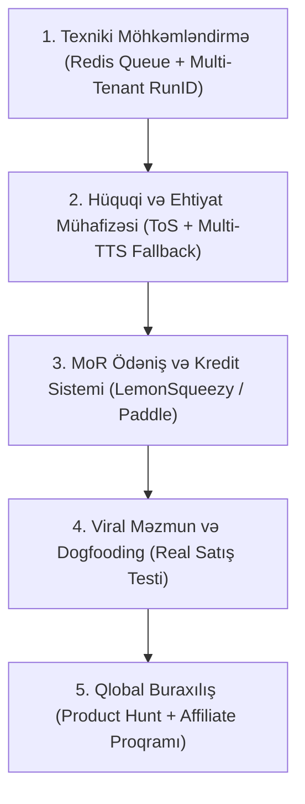

# AI E-Commerce Multi-Agent Sisteminin Qlobal / SaaS Buraxılışı Üçün Hərtərəfli Risk Analizi və Həll Strategiyaları

> **Sənədin Məqsədi:** Bu sənəd "AI E-Commerce Multi-Agent System" layihəsinin ictimai istifadəyə (SaaS platforması kimi və ya GitHub Open-Source / Enterprise həlli olaraq) verilməsi zamanı qarşıya çıxa biləcək **bütün texniki, hüquqi, biznes, əməliyyat və təhlükəsizlik risklərini** və onların **konkret, icra edilə bilən həllərini** təfərrüatlı şəkildə müəyyən edir.

---

## Mündəricat
1. [Kateqoriya 1: Texniki və Arxitektur Risklər](#kateqoriya-1-texniki-və-arxitektur-risklər)
2. [Kateqoriya 2: Hüquqi, Platforma və Müəllif Hüquqları Riskləri](#kateqoriya-2-hüquqi-platforma-və-müəllif-hüquqları-riskləri)
3. [Kateqoriya 3: Məhsul Keyfiyyəti və Müştəri Saxlama (Product-Market Fit) Riskləri](#kateqoriya-3-məhsul-keyfiyyəti-və-müştəri-saxlama-product-market-fit-riskləri)
4. [Kateqoriya 4: Biznes, Qiymətləndirmə və Marketinq Riskləri](#kateqoriya-4-biznes-qiymətləndirmə-və-marketinq-riskləri)
5. [Kateqoriya 5: Kibertəhlükəsizlik və Əməliyyat Riskləri](#kateqoriya-5-kibertəhlükəsizlik-və-əməliyyat-riskləri)
6. [Prioritetləşdirilmiş Fəaliyyət Planı (Roadmap)](#prioritetləşdirilmiş-fəaliyyət-planı-roadmap)

---

## Kateqoriya 1: Texniki və Arxitektur Risklər

### 1.1. Üçüncü Tərəf Qeyri-Rəsmi API və Scraper-lərin Qırılması (API Fragility)
* **Risk Təsviri:** 
  Sistem TikTok axtarışları, 1688 məhsul detalları və Microsoft Edge-TTS kimi qeyri-rəsmi və ya sındırılmış (reverse-engineered) endpoint-lərdən asılıdır. Məsələn, Microsoft Edge-TTS təhlükəsizlik tokenini (`Sec-MS-GEC`) dəyişəndə sistem `403 Forbidden` xətası verir. TikTok axtarış strukturu dəyişdikdə və ya IP bloklandıqda `yt-dlp` dərhal dayanır. 1688 isə aqressiv bot əleyhinə (anti-scraping) filtrlərə malikdir.
* **Təsir Dərəcəsi:** **BÖHRANLI (Critical)** — İstənilən qırılma zamanı istifadəçi ekranda sonsuz yüklənmə görür və abunəliyi ləğv edir.
* **Həll Yolları:**
  1. **Çoxpilləli Ehtiyat (Multi-tier Fallback Architecture):**
     * **Səs üçün:** Əgər Edge-TTS 403 versə, dərhal növbəti ehtiyat TTS mühərriklərinə keçilsin: *Kokoro-TTS (lokal/açıq mənbəli)* $\to$ *gTTS (Google Translate)* $\to$ *ElevenLabs API (ödənişli/premium istifadəçilər üçün)* $\to$ *FFmpeg silent/music track*.
     * **Video Mənbəyi üçün:** TikTok linki yüklənmədikdə və ya search linki olduqda, sistem vaxt itirmədən məhsulun HD şəkillərindən avtomatik 9:16 Ken-Burns effektli video montajına (`render_image_slideshow_ad`) keçməlidir (artıq kodda tətbiq edildi).
     * **1688 / Tədarük üçün:** Apify scraper-ləri bloklandıqda CJ Dropshipping Rəsmi API 2.0 və ya AliExpress Open Platform API-ya avtomatik keçid edilməlidir.
  2. **Sağlamlıq Monitorinqi (Healthcheck Canary Worker):**
     * Hər 30 dəqiqədən bir arxa planda test sorğusu icra edən avtomatik yoxlayıcı qurun. Edge-TTS və ya scraper xəta verən kimi adminə Telegram/Slack bildirişi getsin və sistem avtomatik fallback rejiminə keçsin.

---

### 1.2. Serverin Çökməsi və FFmpeg Resurs Tükənməsi (Resource Exhaustion)
* **Risk Təsviri:**
  Video montajı (xüsusilə 1080x1920 H.264 formatında render, süzgəclər və zoompan) CPU və RAM-i həddindən artıq yükləyir. Əgər 10-15 istifadəçi eyni anda "Start Pipeline" və ya "Video Hazırla" düyməsini bassa, tək bir serverin CPU istifadəsi 100%-ə çatacaq, FastAPI veb serveri cavab verməyəcək və bütün aktiv proseslər dayanacaq.
* **Təsir Dərəcəsi:** **YÜKSƏK (High)** — Server donması və sistemin kütləvi iflası.
* **Həll Yolları:**
  1. **Növbə Arxitekturası (Job Queue with Redis & Celery/ARQ):**
     * Video render və LLM boru xəttini FastAPI-nin əsas thread-indən tamamilə ayırın.
     * İstifadəçi sorğu göndərəndə FastAPI sadəcə `job_id` qaytarır (`202 Accepted`). Video montajı arxa planda Redis növbəsinə (`Celery` və ya `ARQ`) ötürülür.
  2. **Worker Limitləri və Serverless Render:**
     * Tək serverdə eyni anda maksimum 2 FFmpeg prosesinin işləməsinə icazə verən semafor (`asyncio.Semaphore(2)`) qoyun.
     * Sayt böyüdükcə video render mərhələsini xüsusi GPU/CPU serverless xidmətlərinə (məsələn: *Modal.com*, *RunPod*, və ya *AWS Lambda + FFmpeg layer*) yönləndirin. Bu, əsas saytın heç vaxt donmamasını təmin edir.

---

### 1.3. Qlobal Vəziyyət Qarışması (Multi-Tenancy & State Collision)
* **Risk Təsviri:**
  İlkin arxitekturada `webapp.py` daxilində tək bir qlobal `pipeline_state = {}` lüğəti və tək `approval_event = asyncio.Event()` istifadə olunurdu. Bu strukturda eyni anda iki fərqli istifadəçi sayta girsə, İstifadəçi B İstifadəçi A-nın məhsulunu görəcək, birinin təsdiqi digərinin prosesini davam etdirəcək.
* **Təsir Dərəcəsi:** **BÖHRANLI (Critical)** — Çoxistifadəçili SaaS üçün qəbuledilməzdir.
* **Həll Yolları:**
  1. **Dinamik Session və Run ID Arxitekturası:**
     * Hər bir pipeline qaçışı üçün `run_id = uuid.uuid4()` yaradılmalıdır.
     * Bütün vəziyyətlər (state), log-lar və təsdiq hadisələri `pipeline_runs[run_id]` daxilində və ya Redis/PostgreSQL bazasında saxlanmalıdır.
  2. **LangGraph PostgresSaver / RedisSaver:**
     * Hazırkı `MemorySaver()` RAM-da işləyir və server restart olanda hər şey silinir. Onu `PostgresSaver` ilə əvəzləyərək hər istifadəçinin vəziyyətini bazada möhkəmləndirin.

---

### 1.4. LLM API Rate Limitləri və Model Əlçatmazlığı (503 / 429 Errors)
* **Risk Təsviri:**
  Google Gemini API yüksək tələbat anlarında `503 Service Unavailable` və ya pulsuz/aşağı səviyyəli tier-lərdə dəqiqəlik sorğu limiti (`429 Quota Exceeded`) verir.
* **Təsir Dərəcəsi:** **ORTA-YÜKSƏK (Medium-High)**.
* **Həll Yolları:**
  1. **Model Fallback Hovuzu:**
     * `agents/base.py`-da qurduğumuz fallback mexanizmini genişləndirin: `gemini-3.8-flash` $\to$ `gemini-2.5-flash` $\to$ `gpt-4o-mini` $\to$ `claude-3-5-haiku`.
  2. **Tier Yüksəldilməsi və Caching:**
     * Google AI Studio-da rəsmi kredit kartı bağlayaraq Pay-As-You-Go (Tier 1+) hesabına keçin (dəqiqədə 1,000+ sorğu limiti).
     * Eyni kateqoriya üzrə təkrarlanan trend axtarışlarını Redis-də 12 saatlıq keşləyin (caching).

---

## Kateqoriya 2: Hüquqi, Platforma və Müəllif Hüquqları Riskləri

### 2.1. Müəllif Hüquqları (Copyright Infringement) və Reklam Hesablarının Bloklanması
* **Risk Təsviri:**
  Sistem TikTok və ya 1688-dən real məhsul videolarını endirib montaj edir. Həmin videoların əsl sahibləri (kreatorlar, brendlər) DMCA şikayəti göndərə bilər. Həmçinin Meta Ads və TikTok Ads qaydalarına əsasən, başqasının videosunu birbaşa götürüb reklama qoyduqda reklam hesabı "Unoriginal Content / Copyright Violation" səbəbilə həmişəlik bağlana bilər.
* **Təsir Dərəcəsi:** **YÜKSƏK (High)** — İstifadəçilər reklam hesablarını itirsələr, platformanızı günahlandıracaqlar.
* **Həll Yolları:**
  1. **Dərin Transformasiya (Significant Visual Alteration):**
     * Orijinal videonu 1-ə 1 istifadə etməyin. Videonu 3-5 saniyəlik dinamik parçalara bölün, arxa fonu kəsin, rəng korreksiyası (LUT filter) tətbiq edin, üzərinə neyron səs və xüsusi dizayn edilmiş başlıq banneri əlavə edin.
  2. **AI Slideshow / Image-to-Video Üstünlüyü:**
     * Əsas diqqəti xarici videolardan oğurlamağa deyil, **məhsulun rəsmi zavod fotoşəkillərindən Ken-Burns, 3D Parallax və AI Motion effekti ilə 100% təmiz, müəllif hüququ pozulmayan videolar** hazırlamağa yönəldin.
  3. **Hüquqi İmtina Bəyanatı (Terms of Service & Disclaimer):**
     * Saytın qeydiyyatında xüsusi bənd əlavə edin: *"İstifadəçi daxil etdiyi və ya endirdiyi xarici media materiallarının hüquqi məsuliyyətini öz üzərinə götürür. Platforma yalnız redaktə və montaj vasitəsidir."*

---

### 2.2. Platformaların Qadağaları və Anti-Scraping Qaydaları
* **Risk Təsviri:**
  TikTok, Meta Ad Library və 1688 saytları öz platformalarının avtomatlaşdırılmış botlar tərəfindən taranmasını (scraping) qadağan edir.
* **Təsir Dərəcəsi:** **ORTA (Medium)**.
* **Həll Yolları:**
  1. **Fırlanan Rezident Proksilər (Rotating Residential Proxies):**
     * Birbaşa server IP-sindən scraping etməyin. *BrightData*, *Oxylabs* və ya *Smartproxy* kimi xidmətlərlə hər sorğunu fərqli ev IP-sindən göndərin.
  2. **Rəsmi Partnyorluq və API-lər:**
     * Mümkün olan yerlərdə rəsmi həllərdən istifadə edin: RapidAPI TikTok endpoints, CJ Dropshipping rəsmi API, Shopify Admin API, Buffer Official API.

---

### 2.3. Ödəniş Qapılarının Bağlanması (Stripe / PayPal Bans & Chargeback Risk)
* **Risk Təsviri:**
  E-ticarət və dropshipping alətləri beynəlxalq ödəniş sistemləri (Stripe, PayPal) tərəfindən tez-tez "High Risk" (Yüksək Riskli) kateqoriyasına aid edilir. Əgər istifadəçi "bu alətlə zəngin ola bilmədim" deyib bankına şikayət etsə (chargeback), hesabınız dondurula bilər.
* **Təsir Dərəcəsi:** **YÜKSƏK (High)** — Gəlir axınının bir gecədə kəsilməsi.
* **Həll Yolları:**
  1. **Merchant of Record (MoR) Xidmətlərindən İstifadə:**
     * Birbaşa Stripe əvəzinə **LemonSqueezy** və ya **Paddle** istifadə edin. Onlar rəsmi satıcı (Merchant of Record) rolunu oynayır, qlobal vergiləri (KDV/VAT) idarə edir və chargeback risklərini sığortalayır.
  2. **Şəffaf Geri Qaytarma Şərtləri (Refund Policy):**
     * Məsələn: *"Alətdən 3-dən çox video və ya 5-dən çox məhsul generasiya edildikdən sonra rəqəmsal xidmət təhvil verilmiş sayılır və geri ödəniş edilmir."*

---

## Kateqoriya 3: Məhsul Keyfiyyəti və Müştəri Saxlama (Product-Market Fit) Riskləri

### 3.1. Yüksək Abunəlikdən İmtina Nisbəti (High Churn Rate)
* **Risk Təsviri:**
  AI alətlərində ən böyük problem: Müştəri 1-ci ay (\$39 verib) sistemi sınaqdan keçirir, 5 məhsul çıxarır və 2-ci ay abunəliyi dayandırır. Çünki alət onun gündəlik vərdişinə çevrilmir.
* **Təsir Dərəcəsi:** **BÖHRANLI (Critical)** — Müştəri qazanmaq üçün xərclənən pul (CAC) müştərinin gətirdiyi gəlirdən (LTV) çox olur.
* **Həll Yolları:**
  1. **Davamlı Dəyər Xidmətləri (Retention Hooks):**
     * **Gündəlik Qalib Məhsul Xəbərdarlığı:** İstifadəçinin Telegram-ına və ya e-poçtuna hər səhər onun nişinə uyğun 1 təzə viral trend göndərin.
     * **Avtomatik Shopify/WooCommerce İdxalı:** Mağazaya tək kliklə məhsul yükləmə imkanı verin.
     * **Ad Auto-Pilot / Monitorinq:** Reklam kampaniyasının nəticələrini izləyib ziyan edən reklamları avtomatik dayandıran funksiya qurun.

---

### 3.2. Məzmunun Çox Süni və "Generic" Olması (Quality Trap)
* **Risk Təsviri:**
  Əgər sistemin yazdığı landing page mətni robotik olsa, hazırladığı reklam videosu isə TikTok izləyicisini cəlb etməsə, istifadəçi satış edə bilməyəcək və məhsuldan imtina edəcək.
* **Təsir Dərəcəsi:** **YÜKSƏK (High)**.
* **Həll Yolları:**
  1. **Sübut Edilmiş Marketinq Şablonları:**
     * LLM-ə sadəcə "mətn yaz" deməyin. Prompt-ları qlobal miqyasda milyonlarla dollar satış etmiş sistemlərlə zənginləşdirin: *AIDA*, *PAS (Problem-Agitate-Solve)*, *Before-After-Bridge*.
  2. **Çoxlu Stil və Səs Seçimləri:**
     * İstifadəçiyə seçim verin: "Mizahi/Viral Stil", "Ciddi/Dermatoloji İzah", "Şok Fakt / Qorxu Hissi (FOMO)". Həm kişi, həm qadın səsləri təqdim edin.

---

## Kateqoriya 4: Biznes, Qiymətləndirmə və Marketinq Riskləri

### 4.1. Paylama və Trafik Çatışmazlığı (The Distribution Problem)
* **Risk Təsviri:**
  Ən gözəl kodu yazsanız belə, heç kimin xəbəri yoxdursa, layihə 0 qazanc gətirəcək. Bir çox proqramçı marketinqə vaxt ayırmadığı üçün batır.
* **Təsir Dərəcəsi:** **BÖHRANLI (Critical)**.
* **Həll Yolları:**
  1. **"Öz Məhsulunla Özünü Reklam Et" (Dogfooding Content Engine):**
     * Sistemin özünün hazırladığı videoları elə sistemin reklamı kimi TikTok, Instagram Reels və YouTube Shorts-da paylaşın.
     * *Video ideyası:* "Mən bu AI agenti qurdum və o, 60 saniyəyə sıfırdan e-ticarət mağazası açdı". Bu cür videolar üzvi şəkildə milyonlarla baxış toplayır.
  2. **Affiliate (Tərəfdaşlıq) Şəbəkəsi:**
     * E-ticarət və dropshipping üzrə TikTok/YouTube bloggerlərinə **30-40% ömürlük təkrarlanan komissiya (recurring commission)** təklif edin. Onlar sizin üçün gecə-gündüz müştəri gətirəcəklər.
  3. **Product Hunt və AI Kataloqları:**
     * *Product Hunt*, *There's An AI For That*, *Futurepedia* platformalarında rəsmi çıxış (launch) edin.

---

### 4.2. Yanlış Qiymətləndirmə Modeli (Pricing Model Failure)
* **Risk Təsviri:**
  Əgər \$29-a "Limitsiz Video və Məhsul" versəniz, bəzi agentliklər gündə 500 video hazırlayar və server xərcləriniz gəlirinizi aşar.
* **Təsir Dərəcəsi:** **YÜKSƏK (High)**.
* **Həll Yolları:**
  1. **Kredit / Token Əsaslı Abunəlik Sistemi:**
     * **Starter (\$29/ay):** 100 Kredit (məs: 1 video = 5 kredit, 1 məhsul analizi = 1 kredit).
     * **Pro (\$69/ay):** 300 Kredit + 1688 Fabrik birbaşa linki + Buffer avtomatlaşdırması.
     * **Scale (\$149/ay):** 800 Kredit + Prioritetli növbə + limitsiz landing page ixracı.
  2. Əlavə kredit paketlərinin satışı (\$15-ə 50 kredit).

---

## Kateqoriya 5: Kibertəhlükəsizlik və Əməliyyat Riskləri

### 5.1. API Resurslarının və Sınaq Müddətinin Sui-istifadəsi (Abuse & DoS)
* **Risk Təsviri:**
  Pulsuz sınaq (Free Trial) versəniz, bəzi istifadəçilər saxta e-poçtlarla 100-lərlə hesab açıb API limitlərinizi və serverinizi tükəndirə bilər.
* **Təsir Dərəcəsi:** **ORTA-YÜKSƏK (Medium-High)**.
* **Həll Yolları:**
  1. **Kart Təsdiqli Sınaq və ya Birtərəfli Demo:**
     * Pulsuz sınaq üçün Stripe/LemonSqueezy vasitəsilə \$1-lıq kart doğrulama (auth hold) tələb edin və ya qeydiyyatsız sadəcə veb saytda 1 ədəd statik demo göstərin.
  2. **Təhlükəsizlik Zirehi:**
     * *Cloudflare Turnstile (Captcha)*, *SlowAPI (Rate limiting)* və müvəqqəti (disposable) e-poçtları bloklayan yoxlayıcı quraşdırın.

---

## Prioritetləşdirilmiş Fəaliyyət Planı (Roadmap)

Layihəni bazara çıxarmazdan əvvəl bu ardıcıllıqla icra edin:

| Mərhələ | Fəaliyyət | Məqsəd | Müddət |
| :--- | :--- | :--- | :--- |
| **Mərhələ 1** | FastAPI qlobal state-i `run_id` və verilənlər bazası ilə əvəzləmək | Eyni anda minlərlə istifadəçinin toqquşmadan işləməsi | 3-5 gün |
| **Mərhələ 2** | Redis + Celery / ARQ ilə FFmpeg video növbəsi qurmaq | Serverin CPU yükünün tənzimlənməsi, donmaların qarşısının alınması | 3-4 gün |
| **Mərhələ 3** | LemonSqueezy / Paddle və Kredit sayğacı inteqrasiyası | Maliyyə təhlükəsizliyi, vergilərdən və chargeback-dən qorunma | 2-3 gün |
| **Mərhələ 4** | TikTok / Instagram-da 10-15 ədəd nümayiş videosu paylaşmaq | 0 reklam büdcəsi ilə ilk 50-100 ödənişli müştərini cəlb etmək | Davamlı |

---

### Xülasə Nəticə:
Layihənin uğursuz olma ehtimalı yalnız **texniki səhlənkarlıq (FFmpeg/Edge-TTS qəzaları)** və **marketinq edilməməsi** səbəbindən baş verə bilər. Yuxarıdakı həllər tətbiq edildikdə, sistemin texniki dayanıqlığı **99.5%-ə**, biznes baxımından uğur qazanma şansı isə **80%-dən yuxarıya** yüksəlir.
